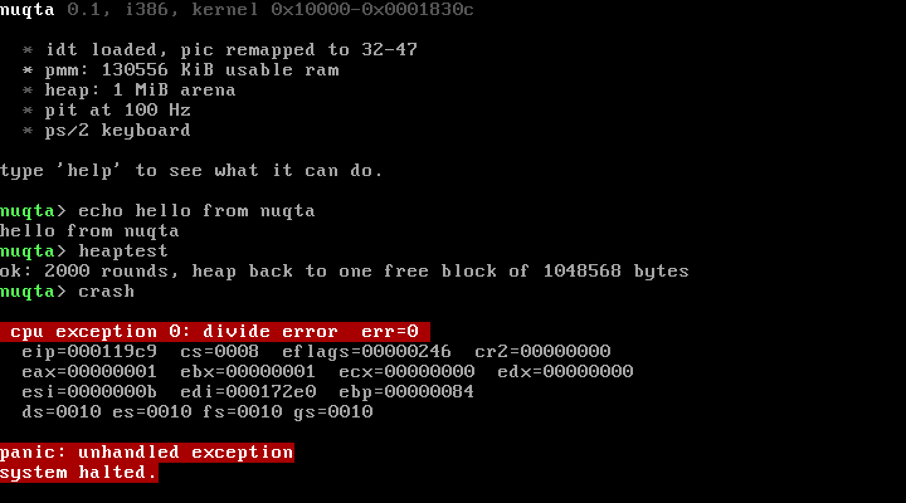

# nuqta

a small x86 operating system i wrote from scratch to understand what actually
happens between pressing the power button and seeing a prompt.

no grub, no libc, no multiboot. a 512 byte boot sector reads the kernel off
the disk, switches the cpu to 32 bit protected mode and jumps into C.

## what it does

- **bootloader** (boot/boot.asm): reads the kernel with BIOS int 13h LBA reads,
  grabs the e820 memory map, opens A20, loads a flat GDT, enters protected mode
- **interrupts**: IDT with all 32 cpu exceptions + 16 hardware IRQs, PIC remapped
  to 32-47, spurious IRQ 7/15 handled properly
- **exceptions**: register dump instead of a silent reboot (try `crash`)
- **timer**: PIT at 100 Hz, uptime and sleep
- **keyboard**: PS/2 driver, shift / caps / ctrl, arrow keys
- **physical memory**: bitmap page allocator built from the real BIOS memory map
- **heap**: kmalloc / kfree, first fit with splitting and merging, magic numbers
  catch double frees. `heaptest` hammers it and checks nothing got corrupted
- **shell**: line editing, history on up/down, ctrl+c, ctrl+l
- everything printed also goes out COM1, so `make run` shows it in your terminal

## build and run

you need `nasm`, `gcc` with 32 bit support, `binutils` and `qemu`.

on ubuntu / debian:

    sudo apt install nasm gcc-multilib qemu-system-x86
    make run

on arch: `nasm gcc qemu-system-x86` and the same `make run`. on mac you want an
i686-elf cross compiler, plain clang wont link this.

`make debug` starts qemu paused with a gdb stub on :1234:

    gdb build/kernel.elf -ex 'target remote :1234' -ex 'b kmain' -ex c

## commands

    help      clear     echo      uptime    cpu       mem
    mmap      alloc     free      peek      heaptest  crash     reboot

`peek 0xb8000 64` is fun, thats the screen itself.

## memory layout

    0x00007c00   boot sector
    0x00008000   e820 map left by the bootloader
    0x00010000   kernel (.text .rodata .data .bss + 16K stack)
    after bss    page bitmap
    0x000b8000   vga text buffer
    0x00100000+  free pages, first 1M of them is the heap arena

## layout

    boot/boot.asm       stage 1, everything before C
    kernel/entry.asm    _start, zeroes bss, sets the stack
    kernel/isr.asm      48 interrupt stubs + common frame
    kernel/idt.c        IDT, PIC, exception dump, irq dispatch
    kernel/pmm.c        page bitmap
    kernel/heap.c       kmalloc / kfree
    kernel/timer.c      PIT
    kernel/kbd.c        PS/2 keyboard
    kernel/vga.c        text mode
    kernel/serial.c     COM1
    kernel/lib.c        mem*, str*, printf, panic
    kernel/shell.c      the shell

## not done yet

paging, user mode, a filesystem, a scheduler. probably in that order.
the bootloader reads a fixed 64 sectors so the kernel has to stay under 32K
(the Makefile yells at you if it doesnt).

## things that helped

- the [OSDev wiki](https://wiki.osdev.org)
- Intel SDM volume 3, chapters 2, 3 and 6
- Ralf Brown's interrupt list for the BIOS calls

## license

MIT
